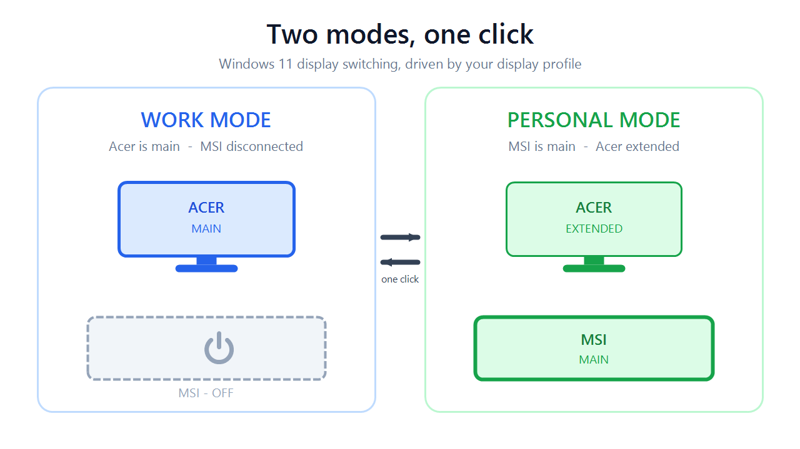

  

# multi-monitor-switcher

  <b>One-click Work / Personal display mode switcher for Windows 11</b>

  

A small tool for people whose desk has more than one monitor — and more than one
owner. Double-click a desktop shortcut and Windows rearranges (or deactivates)
your displays in ~1-2 seconds: which one is **primary**, which are **extended**
where, and which are **turned off** entirely.

**Built for Windows 11.** Developed and tested on Windows 11 25H2 (build 26200);
see [Requirements](#requirements) for details.

The author's configuration, for reference — the tool works with any layout you
describe in `profiles.json`:

| Mode       | MSI MAG401QR (bottom, 3440x1440) | XF270HU / Acer (top, 2560x1440) |
|------------|----------------------------------|----------------------------------|
| **Work**       | turned off ("disconnected")      | **main display**, at (0,0)       |
| **Personal**   | **main display**, at (0,0)       | extended, above and right (420,-1440) |

The laptop's own screen (lid closed) is ignored by both modes.

## Usage

- Double-click the **"Work Mode"** or **"Personal Mode"** desktop shortcut.
- Or from a terminal (PowerShell is built into Windows):
  - `powershell -NoProfile -ExecutionPolicy Bypass -File .\Set-WorkMode.ps1`
  - `powershell -NoProfile -ExecutionPolicy Bypass -File .\Set-PersonalMode.ps1`
  - `powershell -NoProfile -ExecutionPolicy Bypass -File .\Show-DisplayState.ps1` (read-only status)

Switching takes ~1-2 seconds. If a shortcut fails, a message box shows the reason.

The mode you switch to is **persisted across reboots** (it is written to Windows'
display database, the same way the Display Settings dialog does it).

## Requirements

- **Windows 11** — developed and tested on Windows 11 25H2 (build 26200).
  The tool calls the *current* Display Configuration API signature
  (`SetDisplayConfig` with 5 parameters), which recent Windows 11 builds export.
  Older Windows 10 builds export the legacy 8-parameter signature and are
  **not supported**.
- Two or more displays. (The committed profile targets two external monitors;
  the tool handles any number — see [Customizing](#customizing).)
- Nothing else: plain Windows PowerShell 5.1 (built into Windows), no admin
  rights, no third-party dependencies.

## Files

| File | Purpose |
|------|---------|
| `DisplayModes.psm1`     | PowerShell module: drives the engine, verifies the result, corrects the primary if needed |
| `DisplayModes.cs`       | C# core using the Win32 Display Configuration API (`QueryDisplayConfig` / `SetDisplayConfig`) |
| `profiles.json`         | **The active configuration**: which monitor is which (by EDID) and what each mode looks like. The committed copy is the author's setup — replace it with your own (see below). |
| `profiles.example.json` | Blank template describing every field |
| `Set-WorkMode.ps1`      | One-click: work mode |
| `Set-PersonalMode.ps1`  | One-click: personal mode |
| `Show-DisplayState.ps1` | Shows current displays, GDI view, and which mode matches |
| `New-DisplayModeShortcuts.ps1` | (Re)creates the desktop shortcuts |
| `logo.png` / `modes.png`  | README graphics |
| `tools/make-images.ps1`   | Regenerates the two graphics with System.Drawing (dev convenience) |

## How it works

1. Reads the live display topology from the Windows Display Configuration API.
2. Finds your two monitors by their **EDID** (stable across reboots and port swaps):
   - MSI  = EDID `6936:3EA5` ("MSI MAG401QR")
   - Acer = EDID `7204:549`  ("XF270HU")
3. Edits the configuration:
   - **Work**: Acer path activated at (0,0) (which makes it the primary), MSI path deactivated.
   - **Personal**: MSI activated at (0,0) (primary), Acer activated at (420,-1440).
4. Validates the change with `SetDisplayConfig(SDC_VALIDATE ...)` and only then applies it
   with `SDC_APPLY | SDC_USE_SUPPLIED_DISPLAY_CONFIG | SDC_SAVE_TO_DATABASE`.
5. Verifies the result (active set, positions, and that the GDI primary is the monitor
   you expect). If Windows chose a different primary, it falls back to
   `ChangeDisplaySettingsEx(CDS_SET_PRIMARY)`.

Turning a monitor off means its display path is deactivated - the GPU stops driving it,
so the monitor goes into standby on its own. Resolution and refresh rate (160 Hz on the
MSI, 144/160 on the Acer) are preserved from the live configuration; if a monitor had to
be re-activated without a cached mode, Windows best-mode logic selects the native mode.

## Setting up on another machine

1. Copy `profiles.example.json` to `profiles.json`.
2. Run `Show-DisplayState.ps1` — every active display lists its **EDID** (`mfr:prod` in hex).
3. Fill each monitor's `edidMfr`/`edidProd` with those values (the `friendlyName` is just a label).
4. Give your monitors any tags you like (`monitor-a`, `work-screen`, ...) and define your
   modes' `paths`: which monitors are active, and their `position`. The monitor at `[0,0]`
   is the primary; to turn a monitor off, set `"active": false`.
5. Test with `Set-WorkMode.ps1` / `Set-PersonalMode.ps1` (or add your own mode name and
   script), then run `New-DisplayModeShortcuts.ps1` for desktop shortcuts.

The committed `profiles.json` is the author's real setup (MSI MAG401QR bottom + Acer
XF270HU top) — feel free to keep it as a reference, but the tool only ever reads
`profiles.json`.

## Customizing

Edit `profiles.json`:

- **Move a monitor** in a mode: change its `"position": [x, y]`.
  The primary is always the monitor at `[0, 0]`. (Negative y = above, negative x = left.)
- **Add a third monitor**: add it under `monitors` (find its EDID with
  `Show-DisplayState.ps1` / Device Manager) and add a line per mode under `modes.<name>.paths`.
- **Add a new mode**: copy a mode block, change its name, then call
  `Set-DisplayMode -Mode <name>` (or make your own shortcut).

## Troubleshooting

- **"monitor ... not found"**: a monitor is unplugged or the EDID changed (rare).
  Re-run `Show-DisplayState.ps1` and update `profiles.json`.
- **Display went somewhere unexpected**: run `Set-PersonalMode.ps1` or
  `Set-WorkMode.ps1` again to re-assert the layout; if it still misbehaves,
  use Windows Settings > Display to reset manually, then run the mode again.
- **Laptop screen opens**: when you open the lid, Windows activates the internal
  display; it will not steal the primary as long as MSI/Acer stays at (0,0).
  Closing the lid returns everything to the saved mode automatically.
- No admin rights are required; the scripts must run in your own user session
  (the desktop shortcuts do this).
